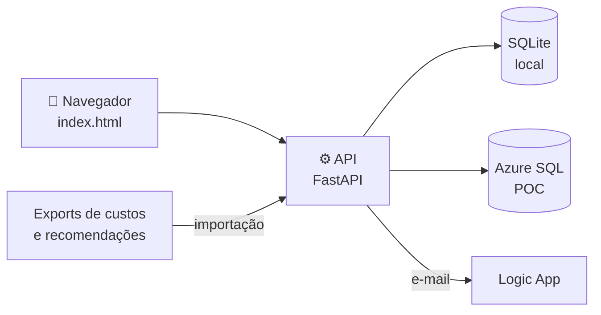

<div align="center">

# 📊 Dashboard FinOps

**Acompanhamento mensal das recomendações de eficiência financeira em ambientes multicloud, da identificação à captura do saving.**

[](https://github.com/rafabiasotto/dash-finops/actions/workflows/ci.yml)
[](https://github.com/rafabiasotto/dash-finops/actions/workflows/deploy-poc.yml)


[Funcionalidades](#funcionalidades) · [Execução local](#execução-local) · [Processo mensal](#processo-mensal) · [Publicação](#publicação-e-infraestrutura-da-poc) · [Roadmap](#roadmap)

</div>

---

Centraliza recomendações, acompanhamento por Squad, custos, **Saving Efetivo**, **Rescaldo** e SLAs do processo FinOps. Os dados ficam num banco SQLite (uso local) ou no Azure SQL (POC publicada).

## Sumário

- [Visão geral](#visão-geral)
- [Funcionalidades](#funcionalidades)
- [Estrutura do repositório](#estrutura-do-repositório)
- [Execução local](#execução-local)
- [Variáveis de ambiente](#variáveis-de-ambiente)
- [Processo mensal](#processo-mensal)
- [Custos](#custos)
- [Competências fechadas](#competências-fechadas)
- [Backup](#backup)
- [Princípios de desenvolvimento](#princípios-de-desenvolvimento)
- [Publicação e infraestrutura da POC](#publicação-e-infraestrutura-da-poc)
- [Levar para outra organização](#levar-para-outra-organização)
- [Versionamento](#versionamento)
- [Roadmap](#roadmap)

## Visão geral

- **Frontend:** `frontend/index.html`, arquivo único (HTML, CSS e JavaScript) servido pela própria API.
- **API:** FastAPI (`api/`), responsável por ler, gravar e validar os dados.
- **Banco:** fonte oficial dos dados. Local: SQLite (`database/finops_dev.db`). POC: Azure SQL, ligado pelas variáveis `FINOPS_SQL_*`. O navegador guarda apenas cache; se houver divergência, vale o banco.



## Funcionalidades

| Área | O que faz |
|---|---|
| Recomendações | Cadastro, status (análise, aprovada, reprovada, adiada), realizado, tickets e IDs `FINOPS-xxxxxx` |
| Importação | "Novas recomendações" (exports brutos) e "Atualizar planilha" (planilha oficial), sempre com prévia |
| Indicadores | Potencial, Saving Est., Saving Efetivo, Rescaldo previsto e herdado, eficiência |
| Squads e SLA | Visão por Squad, chamados, prazos e envio de e-mail |
| Custos | Exports por competência e provedor, usados nos cálculos |
| Governança | Competências fechadas, auditoria de alterações e backup automático |

## Estrutura do repositório

<details>
<summary><b>📁 Ver a árvore de pastas</b></summary>

```text
dash-finops/
├── api/
│   ├── main.py              rotas da API e regras de persistência
│   ├── db.py                conexão e caminho do banco
│   ├── cost_service.py      leitura e gravação dos exports de custos
│   ├── backup_service.py    backup automático do SQLite
│   ├── email_service.py     envio de e-mail (Logic App)
│   └── sqldb.py             camada de dialeto SQLite / Azure SQL
├── database/
│   └── schema.sql           todas as tabelas; a API aplica ao abrir o SQLite (cria o que faltar)
├── docs/
│   ├── AZURE_SQL.md         como funciona o modo Azure SQL
│   ├── MIGRACAO.md          checklist para levar o projeto a outra organização
│   ├── CHANGELOG.md         histórico de versões
│   └── golden_numeros.json  números de referência das competências fechadas
├── frontend/
│   └── index.html
├── tools/
│   ├── verifica_numeros.py  confere as competências fechadas contra o golden
│   ├── freeze_competencia.py  fecha uma competência no SQLite (triggers)
│   └── migrar_sqlite_para_azure_sql.py  copia o SQLite para o Azure SQL
├── tests/                   unittest (só biblioteca padrão)
├── infra/                   Terraform da POC e pos_apply.ps1 (ver infra/README.md)
├── .github/workflows/       ci (PRs), deploy-poc (main) e infra (Terraform)
├── requirements.txt
└── .env.example
```

</details>

Ficam **fora do Git** (ver `.gitignore`) e existem apenas na máquina local: `database/*.db`, `data/`, `config/squads.json`, planilhas (`*.xlsx`, `*.csv`) e, em `infra/`, o `terraform.tfvars` e o state. Backups do banco e o baseline do dashboard original ficam fora do repositório (ex.: `C:\Dash-Finops\backup_poc`).

## Execução local

```powershell
.\.venv\Scripts\Activate.ps1
python -m uvicorn api.main:app --reload --host 127.0.0.1 --port 8000
```

Acesse `http://127.0.0.1:8000/`.

Instalação das dependências: `pip install -r requirements.txt` (testado em Python 3.13).

## Variáveis de ambiente

| Variável | Uso |
|---|---|
| `FINOPS_DB_PATH` | caminho do SQLite (padrão `database/finops_dev.db`) |
| `FINOPS_REQUIRE_AUTH=1` | exige o cabeçalho `x-ms-client-principal-name` (Easy Auth / SSO); sem ele a API responde 401. Sem a variável, o usuário registrado é `dev-local` |
| `FINOPS_BACKUP=1`, `FINOPS_BACKUP_DIR`, `FINOPS_BACKUP_HORAS`, `FINOPS_BACKUP_MANTER` | backup automático (padrão: a cada 6 h, mantém 20) |
| `LOGIC_APP_URL` | endereço do gatilho HTTP do Logic App que envia e-mail |
| `FINOPS_EMAIL_OVERRIDE_TO` | redireciona todos os envios para um único endereço (com [TESTE] no assunto) |
| `FINOPS_EMAIL_TIMEOUT` | tempo limite do envio de e-mail, em segundos (padrão 30) |
| `FINOPS_RECS_CACHE_TTL_S` | validade do cache da listagem de recomendações no Azure SQL, em segundos (padrão 300) |
| `FINOPS_SQL_SERVER`, `FINOPS_SQL_DB`, `FINOPS_SQL_USER`, `FINOPS_SQL_PASSWORD` | liga o Azure SQL no lugar do SQLite (sem `FINOPS_SQL_SERVER` o app usa SQLite). Ajustes de conexão (`FINOPS_SQL_RETRIES`, `_RETRY_S`, `_TDS`, `_PORT`) em `docs/AZURE_SQL.md` |

> [!CAUTION]
> Nunca coloque valores reais no repositório. Use `.env` (ignorado pelo Git); `.env.example` mostra os nomes.

## Processo mensal

Cada mês é uma **competência** (por exemplo `2026-10`).

> [!NOTE]
> Setembro/2026 está **fechado**; Outubro/2026 está ativo.

### Importar recomendações

Há dois caminhos, que levam ao mesmo resultado:

- **Novas recomendações:** recebe os exports brutos (Advisor, Pier Cloud, Workbook, Squad, Solo). Adiciona só o que é realmente novo, reconhecendo o mesmo recurso pela identidade canônica (ignora variações de nome, SKU e sufixos). As novas recebem ID `FINOPS-xxxxxx` e a data do primeiro dia do mês. Mostra uma prévia antes de aplicar.
- **Atualizar planilha:** recebe a planilha oficial (aba `tabela`). Célula vazia significa "não alterar". Itens ausentes na planilha são mantidos, a menos que se marque a opção de removê-los.

O `FinOpsOpportunityId` é a chave que preserva o histórico entre competências, planilhas, chamados e Saving. Importar de novo não cria duplicidade.

### Virada de mês

Ao criar a competência seguinte, as recomendações pendentes (em análise, adiadas, aprovadas ainda não realizadas) são herdadas pelo novo mês. Ao abrir um mês de Outubro em diante, a tela chama `POST /api/recomendacoes/{origem}/reconciliar-pendencias/{destino}`; a API só aceita o destino que for o mês seguinte da origem.

### Rescaldo

O Rescaldo previsto de um mês passa a ser o **Rescaldo herdado** do mês seguinte. A regra vale de Outubro/2026 em diante (Setembro é o mês-base).

### Valores nos indicadores

Os KPIs em reais aparecem abreviados (por exemplo `R$ 291,9k`, `R$ 1,2M`). O valor completo aparece ao passar o mouse.

## Custos

Os exports de custos são gravados por competência e provedor e usados nos cálculos de Saving Efetivo e Rescaldo.

```text
Arquivo de custos -> Validação / Prévia -> API -> SQLite -> Recálculo -> Dashboard
```

Uma nova base de custos só substitui a anterior depois que a gravação no SQLite é confirmada.

## Competências fechadas

Depois de fechada, uma competência não pode mais ter seus valores financeiros alterados (Saving Est., Realizado, Saving, Saving Efetivo e Rescaldo previsto). A proteção existe em três camadas: tela, API e triggers no banco, todas ligadas à tabela `competencias_fechadas`. Tentativas de alteração são bloqueadas e registradas na tabela de auditoria.

Comandos úteis:

```powershell
# conferir se a competência fechada continua idêntica ao golden (somente leitura)
python tools\verifica_numeros.py VERIFICAR database\finops_dev.db 2026-09

# fechar uma competência no SQLite (simular antes de aplicar; com o servidor parado)
python tools\freeze_competencia.py SIMULAR database\finops_dev.db 2026-09
```

No Azure SQL, os triggers vêm do migrador (`--triggers`).

> [!IMPORTANT]
> Qualquer alteração no código de cálculo deve ser seguida de `verifica_numeros.py`: o resultado precisa ser `OK`.

## Backup

Com `FINOPS_BACKUP=1`, a API copia o SQLite periodicamente para a pasta de backups. No Azure SQL o backup em disco fica desligado (o serviço tem backup próprio).

## Princípios de desenvolvimento

- Dados operacionais, custos, planilhas e configurações reais não vão para o Git.
- Nenhuma alteração sobrescreve dados sem validação; falhas de persistência não são mascaradas por armazenamento local.
- Alterações preservam os identificadores das recomendações.
- Competências fechadas permanecem imutáveis.

Fluxo de trabalho: alterar, validar tecnicamente, validar no dashboard, rodar `verifica_numeros.py`, commitar e enviar para a branch `dev`. Cada commit deve representar um estado funcional.

## Publicação e infraestrutura da POC

A POC é um App Service pessoal (`dash-recomendacao-rb-tf`, Central US, SSO por Easy Auth) com Azure SQL Basic como banco.

**Fluxo de publicação**

1. Criar uma branch a partir da `dev`, alterar e abrir PR para a `dev`. A `dev` é protegida: só entra por PR.
2. O workflow `ci` roda no PR (`.github/workflows/ci.yml`): compila o Python, roda `tests/` (unittest, só biblioteca padrão) e o gitleaks (procura segredos no código e no histórico). O PR só deve ser mesclado com os dois jobs verdes.
3. Para publicar, abrir PR `dev` → `main` e mesclar. O push na `main` dispara `deploy-poc` (`.github/workflows/deploy-poc.yml`): testes, zip do código, `azure/login` por OIDC, `az webapp deploy` e teste rápido do site (aceita 200/301/302/401).
4. Depois do merge, rodar `git pull` na cópia local para ela ficar igual ao repositório.

**Configuração no GitHub**

- Variáveis do repositório: `AZURE_CLIENT_ID`, `AZURE_TENANT_ID`, `AZURE_SUBSCRIPTION_ID`, `TF_RESOURCE_GROUP`, `TF_APP_NAME`; para o workflow de infra também `TF_PLAN_NAME`, `EASYAUTH_CLIENT_ID` e, com state remoto, `TF_BACKEND_READY`.
- Secrets: `SQL_ADMIN_PASSWORD` (infra) e, no environment `poc`, `EASYAUTH_CLIENT_SECRET`. Credenciais federadas (OIDC) na service principal usada pelo login; o subject do OIDC do GitHub usa IDs numéricos: `repo:<dono>@<id>/<repo>@<id>:environment:poc`.
- O deploy não usa senha nem publish profile.

**Infraestrutura (Terraform)**

A infra da POC está em `infra/`. O workflow `infra` roda `plan` em PRs que mexem em `infra/`; enquanto o state for local, esse plan não vale como conferência (mostra tudo como novo) e o `apply` é feito na máquina. Depois de um `apply`, o `infra/pos_apply.ps1` grava senha e segredos, carrega os dados e publica o código. Roteiro completo em `infra/README.md`.

**Banco**

- SQLite é o padrão; o Azure SQL entra pelas variáveis `FINOPS_SQL_*`. Migração dos dados: `tools/migrar_sqlite_para_azure_sql.py <arquivo.db> APLICAR` (sem `APLICAR` só simula; `--recriar` apaga e recria as tabelas, `--triggers` cria os gatilhos de competência fechada).
- O firewall do SQL precisa liberar serviços do Azure e, para rodar a migração, o IP de quem executa. Remover a regra do IP depois.

<details>
<summary><b>⚡ Desempenho e cache</b></summary>

**`/api/custos/persistidos`**

O payload de custos é grande (~90 MB de JSON). O servidor guarda uma versão gzip em memória, indexada por ETag, e a aquece no startup (leva ~1 min depois de cada deploy). O navegador revalida com `If-None-Match` e recebe 304 quando nada mudou. O front só reenvia o estado de uma recomendação se o conteúdo mudou desde o último envio confirmado, e junta as gravações disparadas quase juntas numa única chamada (`POST /api/recomendacoes/{competencia}/estado-completo-lote`, uma transação, tudo ou nada). O log `[custos-cache]` mostra os tempos de leitura, JSON e gzip.

A listagem `GET /api/recomendacoes/{competencia}` também tem cache em memória no modo Azure SQL (sem filtros). Ele é invalidado a cada commit que escreve em `recommendations` (com versão nova a leitura é sempre refeita na hora, nunca se serve dado velho). Passados 5 minutos (`FINOPS_RECS_CACHE_TTL_S`), a requisição ainda recebe o que está em memória e uma releitura em segundo plano atualiza o cache, para cobrir alterações feitas fora do app (migração, SQL manual) sem que ninguém pague a leitura fria depois de um intervalo sem uso. Gravações que não mudam nenhum valor são ignoradas, para não invalidar o cache à toa. No lote, o estado atual das linhas é lido numa única consulta e só as linhas que mudam passam pelo caminho completo. No startup (Azure SQL) as 2 competências mais recentes são lidas em segundo plano para aquecer o cache. Vale para 1 instância com 1 worker, como está hoje; com mais instâncias, o cache de cada uma só se atualiza pelo TTL.

</details>

## Levar para outra organização

Veja `docs/MIGRACAO.md`: checklist de repositório, configuração, variáveis, publicação (App Service, SSO) e validação final.

## Versionamento

Segue [SemVer](https://semver.org/lang/pt-BR/) (`vMAJOR.MINOR.PATCH`), com tags criadas na `main`:

| Mudança | Versão |
|---|---|
| Correção de cálculo ou ajuste visual | PATCH (`v1.0.1`) |
| Funcionalidade nova | MINOR (`v1.1.0`) |
| Mudança que altera a forma de uso | MAJOR (`v2.0.0`) |

Versões candidatas usam `-rc.N` e são marcadas como *Pre-release*. Cada competência fechada recebe também uma tag `fechamento-AAAA-MM`, que registra a versão do código que calculou aqueles números. Histórico em [Releases](https://github.com/rafabiasotto/dash-finops/releases) e `docs/CHANGELOG.md`.

## Roadmap

- [x] Visão geral, Saving, Execução e Detalhamento no novo layout
- [x] Saving Efetivo de resize pelo preço efetivo e troca de tier de disco
- [x] Competências fechadas protegidas em tela, API e banco
- [ ] Login corporativo (Entra ID) no ambiente da empresa
- [ ] Extração diária automática de custos do PierCloud
- [ ] Acesso segregado por squad, com resposta direto no dash (piloto: Bancos)
